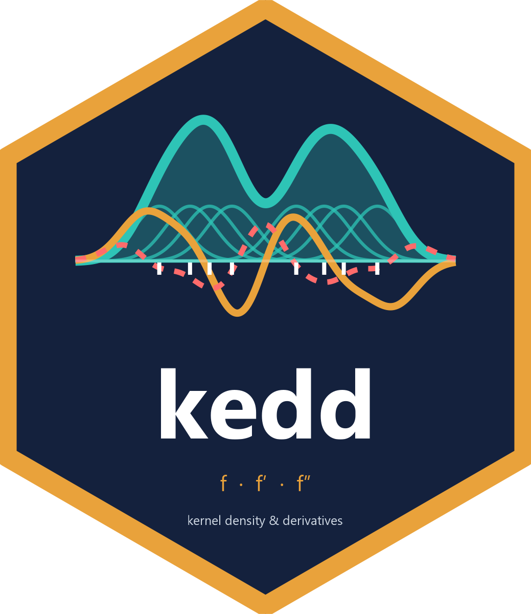
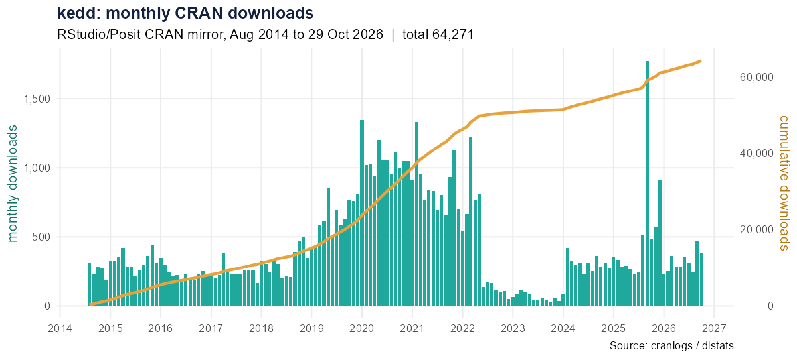

# kedd — Kernel Estimator and Bandwidth Selection for Density and Its Derivatives 

[](https://cran.r-project.org/package=kedd)
[](https://cran.r-project.org/web/checks/check_results_kedd.html)
[](https://github.com/ac-guidoum/kedd/actions/workflows/R-CMD-check.yaml)
[](https://cran.r-project.org/package=kedd)
[](https://cran.r-project.org/package=kedd)
[](https://cran.r-project.org/package=kedd)

The `kedd` package (v2.0.0) provides nonparametric kernel smoothing tools for
[R](https://www.r-project.org/): kernel estimation of a density **and of its
derivatives of any order r**, kernel functions, their derivatives and
convolutions, and eight data-driven bandwidth selectors. Results are S4 objects
with ggplot2 graphics; the $O(n^2)$ criteria run in C++ (Rcpp) with OpenMP.

**Authors:** Arsalane Chouaib Guidoum (author, maintainer) and Amel Henider
(contributor) — see [Authors](#authors).

## Features

### Kernel functions (10 named kernels + the Pow(s,t) family)

| Kernel | Formula | Support |
|--------|---------|---------|
| Gaussian | $K(x) = \frac{1}{\sqrt{2\pi}} e^{-x^2/2}$ | $(-\infty, +\infty)$ |
| Epanechnikov | $K(x) = \frac{3}{4}(1-x^2)$ | $[-1, 1]$ |
| Uniform | $K(x) = \frac{1}{2}$ | $[-1, 1]$ |
| Triangular | $K(x) = 1-\lvert x\rvert$ | $[-1, 1]$ |
| Biweight | $K(x) = \frac{15}{16}(1-x^2)^2$ | $[-1, 1]$ |
| Triweight | $K(x) = \frac{35}{32}(1-x^2)^3$ | $[-1, 1]$ |
| Tricube | $K(x) = \frac{70}{81}(1-\lvert x\rvert^3)^3$ | $[-1, 1]$ |
| Cosine | $K(x) = \frac{\pi}{4}\cos\left(\frac{\pi x}{2}\right)$ | $[-1, 1]$ |
| Silverman | $K(x) = \frac{1}{2}e^{-\lvert x\rvert/\sqrt{2}}\sin\left(\frac{\lvert x\rvert}{\sqrt{2}}+\frac{\pi}{4}\right)$ | $(-\infty, +\infty)$ |
| Logistic | $K(x) = \frac{e^{-x}}{(1+e^{-x})^2} = \frac{1}{4}\mathrm{sech}^2(x/2)$ | $(-\infty, +\infty)$ |
| Pow(s,t) | $K(x) = c_{s,t}(1-\lvert x\rvert^s)^t$, $c_{s,t} = \frac{s}{2B(1/s,\,t+1)}$ | $[-1, 1]$ |

Kernels with support $[-1, 1]$ are zero outside it.

The power family is passed as `kernel = "pow(s,t)"` (or `kernel.pow(s, t)`)
and contains uniform `pow(s,0)`, triangular `pow(1,1)`, Epanechnikov `pow(2,1)`,
biweight `pow(2,2)`, triweight `pow(2,3)` and tricube `pow(3,3)`. Any
$s > 0$, $t \ge 0$ is allowed; derivatives up to order 16 are computed
exactly and the constants $\mu_2(K)$, $\mu_4(K)$, $R(K)$ come from Beta
functions. Logistic derivatives are available up to order 20.

### Bandwidth selectors

| Function | Method | Derivative order r | Reference |
|----------|--------|:---:|-----------|
| `h.amise` | Asymptotic MISE rule (normal reference) | any | Wand & Jones (1995) |
| `h.ucv` | Unbiased (least-squares) Cross-Validation | any | Rudemo (1982), Bowman (1984) |
| `h.bcv` | Biased Cross-Validation (BCV1, BCV2) | any | Scott & Terrell (1987) |
| `h.ccv` | Complete Cross-Validation | any | Jones & Kappenman (1991) |
| `h.mcv` | Modified Cross-Validation | any | Stute (1992) |
| `h.tcv` | Trimmed Cross-Validation | any | Feluch & Koronacki (1992) |
| `h.scv` | Smoothed Cross-Validation (Gaussian kernel) | any | Hall, Marron & Park (1992) |
| `h.mlcv` | Maximum-Likelihood Cross-Validation | 0 | Habbema et al. (1974), Duin (1976) |

All selectors return an S4 object of class `bandwidth`; the search interval is
`[0.01 * hos, 2 * hos]` by default, `hos` being the over-smoothing bandwidth.

### Main functions

- `kernel.fun()` — evaluate $K^{(r)}(x)$ → S4 class `kfun` with `show()` and `plot()`
- `kernel.conv()` — evaluate $(K^{(r)} * K^{(r)})(x)$ → S4 class `kconv`
- `kernel.pow(s, t)` — name of a Pow(s,t) kernel, usable in every function
- `dkde()` — kernel density (or derivative) estimate → S4 class `dkde`
- All bandwidth selectors return an S4 class `bandwidth` with `show()` and `plot()`
- All graphics use ggplot2; `lines(bw)` returns a layer: `plot(bw1)$plot + lines(bw2)`

## Installation

```r
# Development version 2.0.0 from GitHub
# install.packages("remotes")
remotes::install_github("ac-guidoum/kedd", build_vignettes = TRUE)

# Version 2.0.0 from the source tarball
install.packages("kedd_2.0.0.tar.gz", repos = NULL, type = "source")

# or from the source directory
devtools::install("path/to/kedd_2.0.0")

# Released version on CRAN
install.packages("kedd")
```

Version 2.0.0 compiles C++ code: on Windows this needs
[Rtools](https://cran.r-project.org/bin/windows/Rtools/).

## Quick start

```r
library(kedd)
x <- rnorm(500)

# Kernel density estimate (bandwidth chosen by UCV when h is missing)
d <- dkde(data = x, kernel = "gaussian")
plot(d)

# First derivative with its own bandwidth
h1 <- h.scv(x, deriv.order = 1)
plot(dkde(data = x, h = h1@h, deriv.order = 1))

# Bandwidth selectors
h.ucv(x)       # unbiased CV
h.bcv(x)       # biased CV
h.scv(x)       # smoothed CV (Gaussian kernel)

# Kernel function evaluation
kf <- kernel.fun(kernel = "epanechnikov", deriv.order = 1L)
plot(kf)

# Logistic and Pow(s,t) kernels
h.ucv(x, kernel = "logistic")
h.bcv(x, kernel = kernel.pow(2, 4))          # same as kernel = "pow(2,4)"
plot(kernel.fun(kernel = "pow(1.5,2.5)", deriv.order = 1L))

# Overlay two CV curves (ggplot2)
p <- plot(h.ucv(x))
p$plot + lines(h.bcv(x))
```

## Datasets

Five samples of size 200 from the Marron & Wand (1992) normal mixtures, with
known true densities (see `?"kedd-data"`):

| Dataset | Marron & Wand density |
|---|---|
| `kurtotic` | #4 kurtotic unimodal: $\frac23 N(0,1) + \frac13 N(0, 0.1^2)$ |
| `outlier` | #5 outlier: $\frac1{10} N(0,1) + \frac9{10} N(0, 0.1^2)$ |
| `bimodal` | #7 separated bimodal: $\frac12 N(-1.5, 0.5^2) + \frac12 N(1.5, 0.5^2)$ |
| `trimodal` | #9 trimodal: $\frac9{20} N(-1.2, 0.6^2) + \frac9{20} N(1.2, 0.6^2) + \frac1{10} N(0, 0.25^2)$ |
| `claw` | #10 claw: $\frac12 N(0,1) + \sum_{l=0}^{4}\frac1{10} N(l/2-1, 0.1^2)$ |

```r
h.mcv(claw)
plot(dkde(data = bimodal, h = h.ucv(bimodal, deriv.order = 1)@h, deriv.order = 1))
```

## Cheatsheet

A two-page summary of the package is available in
[`cheatsheet/kedd-cheatsheet.pdf`](cheatsheet/kedd-cheatsheet.pdf)
(source: `cheatsheet/kedd-cheatsheet.html`).

## Vignette and demos

```r
vignette("kedd", package = "kedd")   # theory, kernels, estimators, selectors, examples
demo(package = "kedd")               # list of demos
demo("kedd", package = "kedd")       # quick tour
demo("kernels", package = "kedd")    # kernels, derivatives, convolutions, Pow(s,t)
demo("bandwidths", package = "kedd") # all selectors compared on a bimodal sample
```

## Tests

The `testthat` suite (≈1,460 expectations) covers every selector × kernel, the
`nthreads` behaviour, the content of every ggplot2 figure (`plot()`, `lines()`),
the datasets and input validation. It
checks every kernel constant ($\mu_2$, $\mu_4$, $R(K^{(r)})$), convolution and
derivative, for every kernel and every implemented order, against numerical
integration, and checks Pow(s,t) against the named kernels it generalises
(identical kernels, convolutions and bandwidths).

```r
covr::package_coverage("path/to/kedd_2.0.0")   # line coverage
source("data-raw/benchmark.R")                 # execution time of every function
```

## Downloads

CRAN downloads of `kedd` from the RStudio/Posit CRAN mirror, obtained with
[`cranlogs`](https://CRAN.R-project.org/package=cranlogs) (daily counts since
2014) and cross-checked with [`dlstats`](https://CRAN.R-project.org/package=dlstats)
(monthly counts; identical on the 69 months both cover, Jan 2021 – Sep 2026).



| Statistic (as of 29 Oct 2026) | Value |
|---|---:|
| Total downloads (Aug 2014 – Oct 2026) | **64,271** |
| Last month | 387 |
| Last week | 54 |
| Monthly mean / median | 437 / 309 |
| Best month | Sep 2025 (1,776) |

| Year | 2014* | 2015 | 2016 | 2017 | 2018 | 2019 | 2020 | 2021 | 2022 | 2023 | 2024 | 2025 | 2026* |
|---|---:|---:|---:|---:|---:|---:|---:|---:|---:|---:|---:|---:|---:|
| Downloads | 1,285 | 3,872 | 2,818 | 2,918 | 3,856 | 7,657 | 12,813 | 10,566 | 4,844 | 743 | 3,462 | 6,260 | 3,177 |

\* partial years (from Aug 2014; to 29 Oct 2026). The badges above are live; the
figures in this section are a snapshot.

```r
library(cranlogs)
sum(cran_downloads("kedd", from = "2014-08-01", to = Sys.Date() - 1)$count)  # total
cran_downloads("kedd", when = "last-month")

library(dlstats)
x <- cran_stats("kedd")          # monthly downloads
plot_cran_stats("kedd")
```

The figure and the numbers are regenerated with `source("data-raw/downloads.R")`.

## Authors

| Name | Role | Contact |
|------|------|---------|
| **Arsalane Chouaib Guidoum** | author, maintainer | <acguidoum@univ-tam.dz> · ORCID [0000-0003-3781-2160](https://orcid.org/0000-0003-3781-2160) |
| **Amel Henider** | contributor | <amel.henider@univ-tam.dz> |

Source code: <https://github.com/ac-guidoum/kedd> · bug reports and
suggestions: <https://github.com/ac-guidoum/kedd/issues>.

To cite the package (`citation("kedd")`):

> Guidoum, A. C. (2020). Kernel estimator and bandwidth selection for density
> and its derivatives: the kedd package. arXiv:2012.06102.
> <https://doi.org/10.48550/arXiv.2012.06102>

## References

- Bowman, A. (1984). An alternative method of cross-validation for the smoothing
  of kernel density estimates. *Biometrika*, **71**, 353–360.
- Duin, R. P. W. (1976). On the choice of smoothing parameters of Parzen
  estimators of probability density functions. *IEEE Transactions on Computers*,
  **C-25**, 1175–1179.
- Feluch, W. and Koronacki, J. (1992). A note on modified cross-validation in
  density estimation. *Computational Statistics and Data Analysis*, **13**, 143–151.
- Guidoum, A. C. (2020). Kernel estimator and bandwidth selection for density and
  its derivatives: the kedd package. arXiv:2012.06102.
- Habbema, J. D. F., Hermans, J. and Van den Broek, K. (1974). A stepwise
  discrimination analysis program using density estimation. *Compstat 1974*,
  Physica Verlag, Vienna.
- Hall, P., Marron, J. S. and Park, B. U. (1992). Smoothed cross-validation.
  *Probability Theory and Related Fields*, **92**, 1–20.
- Jones, M. C. and Kappenman, R. F. (1991). On a class of kernel density estimate
  bandwidth selectors. *Scandinavian Journal of Statistics*, **19**, 337–349.
- Marron, J. S. and Wand, M. P. (1992). Exact mean integrated squared error.
  *The Annals of Statistics*, **20**, 712–736.
- Rudemo, M. (1982). Empirical choice of histograms and kernel density
  estimators. *Scandinavian Journal of Statistics*, **9**, 65–78.
- Scott, D. W. and Terrell, G. R. (1987). Biased and unbiased cross-validation
  in density estimation. *JASA*, **82**, 1131–1146.
- Stute, W. (1992). Modified cross validation in density estimation. *Journal of
  Statistical Planning and Inference*, **30**, 293–305.
- Wand, M. P. and Jones, M. C. (1995). *Kernel Smoothing*. Chapman & Hall.
- Wolfgang, H., Marron, J. S. and Wand, M. P. (1990). Bandwidth choice for
  density derivatives. *Journal of the Royal Statistical Society B*, **52**,
  223–232.

